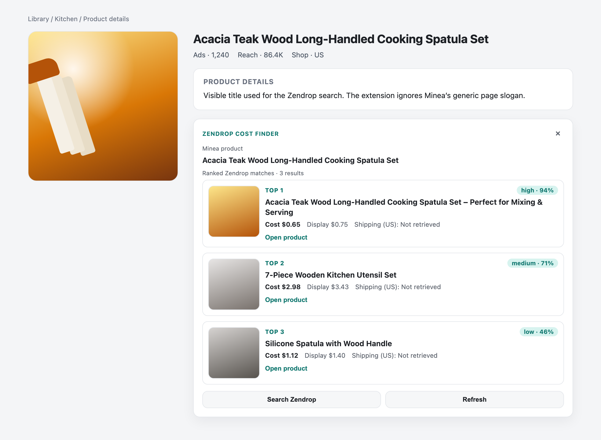
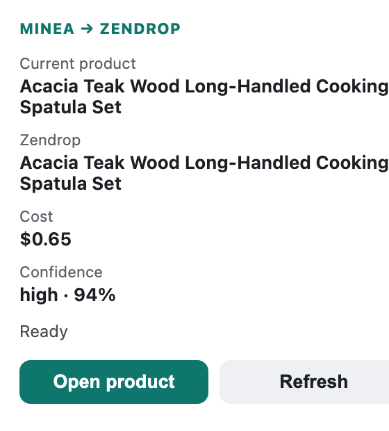

# Minea → Zendrop Cost Finder

Chrome extension that puts Zendrop product cost on a Minea product page. It searches with the Zendrop session already in the browser, ranks the matches, and opens the product page for the one you pick.



## What you see

On a Minea product page the extension reads the visible product title, searches Zendrop, and injects a **Zendrop Cost Finder** card under Product Details.

- Every match shows a thumbnail, cost, and a confidence score.
- The top three are called out. The rest stay in a scrollable list.
- **Open product** goes to `https://app.zendrop.com/product/{id}`.
- The toolbar popup shows the same best match without leaving the page.



Shipping is not loaded, so the card will not call a product profitable. The selling-price helper says so until shipping is known.

## Install

```bash
npm install
npm test
npm run build
```

1. Open `chrome://extensions`.
2. Turn on **Developer mode**.
3. Choose **Load unpacked** and select the `dist/` folder.

You need to be logged into Zendrop and Minea in that Chrome profile. The extension does not ask for a token. If the Zendrop session is missing, the card says:

```text
Zendrop session unavailable — open Zendrop and log in
```

`npm run dev` rebuilds into `dist/` while you work. Reload the extension in Chrome after a rebuild.

## How matching works

```text
Minea product page
        ↓
Visible title (never the generic og:title slogan)
        ↓
GET https://app.zendrop.com/api/product?page=1&search=...
        ↓
Rank response.data
        ↓
Card on the Minea page
```

The background service worker sends that request with `credentials: "include"`. There is no Bearer header, no token in storage, and no `cookies` permission. If a Zendrop tab is already open, search can fall back to that page.

## Develop

```bash
npm test
npm run build
```

| Path | Role |
| --- | --- |
| `src/content` | Detects the Minea product and renders the card |
| `src/background` | Calls the Zendrop API with the browser session |
| `src/popup` | Toolbar summary of the current match |
| `src/shared` | Parsing, ranking, and product URLs |
| `tests` | Parser, matcher, extractor, and URL coverage |

Icons in `icons/` are generated by `scripts/generate-icons.py`.

## Limits

- Matching is by title. Image matching is not implemented.
- Shipping cost is not retrieved, so landed cost is not calculated.
- This does not import products, create stores, or place orders.

Design notes for the MVP live in [Minea_Zendrop_Cost_Finder_Extension_Spec.md](Minea_Zendrop_Cost_Finder_Extension_Spec.md).
